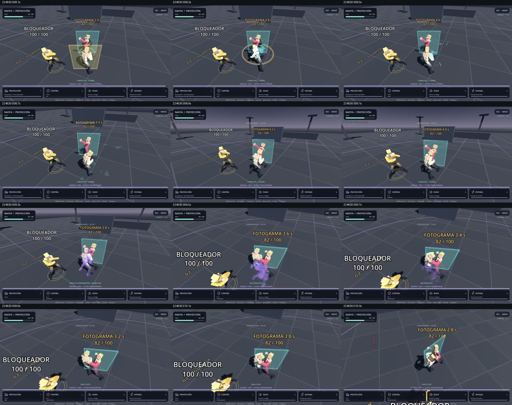
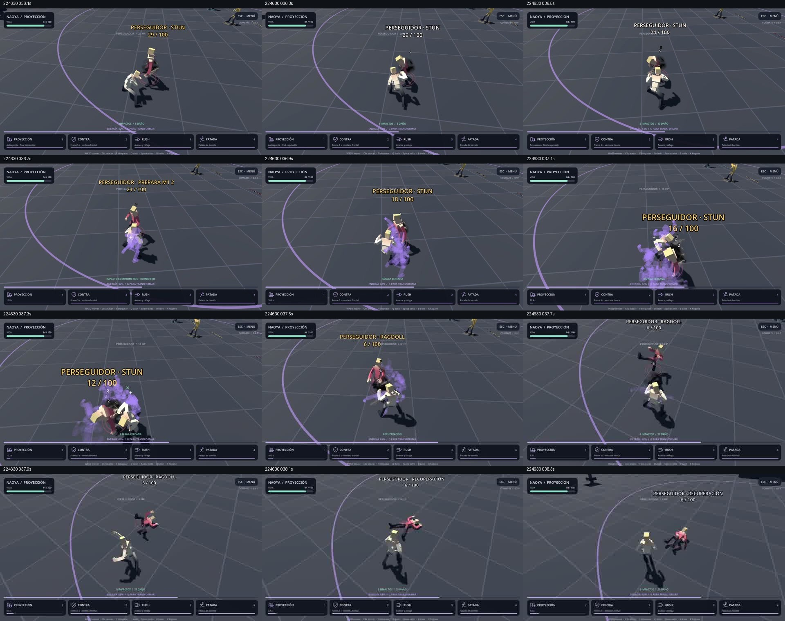

# Revisión de tus grabaciones — Naoya 0.9.1

Estos son videos reales enviados por el usuario, grabados con **Godot 4.7.2**, según su confirmación. No muestran la nueva 0.9.1.1. Las correcciones posteriores se verificaron sobre las mecánicas reales sin renderizar, con el Godot **4.4.1** previamente adjuntado.

| Archivo | Duración | Formato de grabación |
|---|---:|---|
| 2026-10-09 22-39-33.mkv | 91,967 s | 1920×1080, H.264, 144 FPS; AAC estéreo a 48 kHz |
| 2026-10-09 22-46-30.mkv | 43,114 s | 1920×1080, H.264, 144 FPS; AAC estéreo a 48 kHz |

144 FPS es la frecuencia declarada del archivo, no una medición del rendimiento del juego. La ventana de juego ocupa aproximadamente 1280×720 dentro de la grabación del editor. Se revisaron hojas generales cada tres segundos y secuencias específicas cada 0,2 s. Las marcas siguientes son aproximadas respecto al comienzo de cada archivo.

## Hallazgos

| Video / tiempo | Evidencia visible | Acción |
|---|---|---|
| 22-46-30 / 00:08,1–00:13,1 | Counter muestra FOTOGRAMA 5,0 s y desciende; el NPC conserva su pose 3D detrás del panel. | Duración y bloqueo se ven activos. La representación plana 2D sigue pendiente. |
| 22-46-30 / 00:09,3–00:09,7 | El 1 entra en compromiso, consume cooldown y recupera; el blanco congelado continúa en 82 HP. | Se reprodujo un fallo de orientación contra quietos laterales cercanos y se corrigió en 0.9.1.1. La grabación por sí sola no identifica cada variable interna. |
| 22-46-30 / alrededor de 00:10,3 | El nombre BLOQUEADOR crece al acercarse a la cámara y cruza el área inferior. | Texto de NPC con tamaño independiente de distancia y escala reducida; pendiente comprobar la lectura del parche con gráficos. |
| 22-46-30 / 00:36,7–00:37,5 | Ráfaga cercana: 24→18→16→12→6 HP, 18 de daño total. Varias estelas moradas cubren los dos cuerpos. | Conexión y secuencia sí aparecen. Se reduce duración/opacidad y se exige desplazamiento para emitir una estela. |
| 22-46-30 / 00:37,7–00:38,5 | El enemigo cae, permanece en el suelo y se incorpora. | El derribo animado funciona en este caso. Un ragdoll físico articulado aún no está implementado. |
| 22-39-33 / 00:30,9–00:33,1 | Counter termina; un remate pasa al derribo y el NPC se tumba. | Confirma que la caída tiene transición; no corresponde sustituirla basándose solo en el primer instante marcado RAGDOLL. |

Fotogramas de referencia, extraídos de **tus videos de 0.9.1**:

## Reproducción del problema

Antes de corregir, un diagnóstico controlado seleccionó los 35 blancos quietos ensayados, pero falló 16 contactos: a 1,2/1,8/2,2 m y ±30°/±45°, y a 8 m y ±30°/±45°. Los blancos a 4 m sí conectaban en esos ángulos. Tras orientar durante preparación y reducir la desviación de cámara al acercarse, las mismas 35 posiciones reciben 18.

La regresión formal amplía los ángulos hasta ±49°, dentro del cono de 50°, y comprueba también que ±55° queda fuera. Conserva esquiva final, rumbo fijo en compromiso, selección con paredes y daño real. Los registros antes/después y la suite nueva están en `qa/resultados_v0911/`.

## Audio y límites

Se midió la señal AAC de ambos archivos con FFmpeg: media/pico de −28,9/−4,4 dB en el primero y −33,3/−8,0 dB en el segundo. Ninguno llega a 0 dB en esa medición. Estos datos no comprueban calidad de los golpes, sincronía perceptiva ni mezcla de buses. **No se pudo realizar una escucha cualitativa** con las herramientas de esta sesión, ni se cambió el audio basándose solo en esos niveles.

No hay un caso controlado suficiente en estos videos para certificar evasión final, contacto contra muro, renacimiento por muerte y evolución. Los guiones automatizados sí comprueban esas reglas sin imagen. Tampoco se puede certificar suavidad de 0.9.1.1, FPS del renderer o funcionamiento en 4.7.2 a partir de videos de la versión anterior.

## Próxima comprobación manual

En una carpeta nueva, importar `project.godot` de 0.9.1.1. Con un NPC quieto, pulsar 1 desde aproximadamente 1,8 m, apuntando unos 30–45° a un lado: debe conectar 18, sin salto de orientación. Repetir después de un Counter acertado. Con ESQUIVA FINAL, la esquiva lateral debe seguir evitando el golpe. Mirar la separación de estelas y el tamaño del texto al acercar cámara. Esta prueba gráfica cerrará el parche antes del HUD de 0.9.2.
